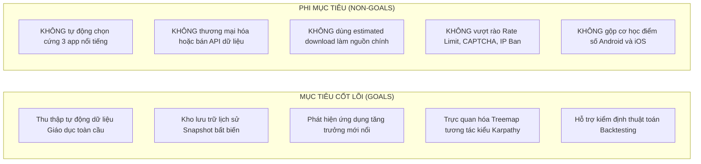
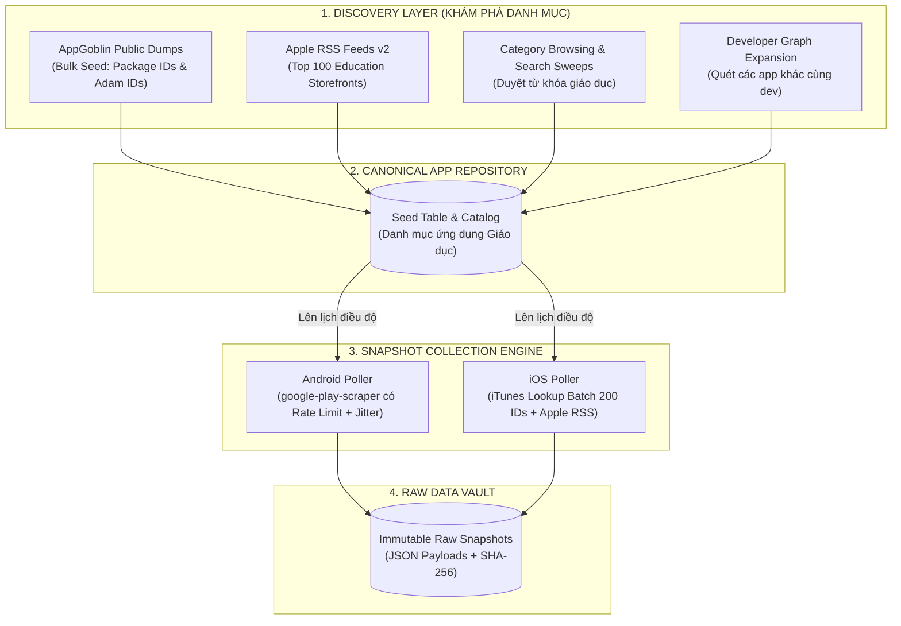
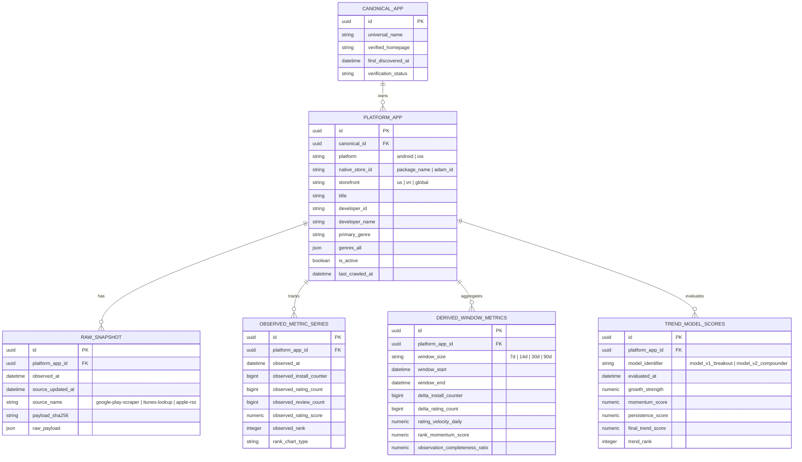
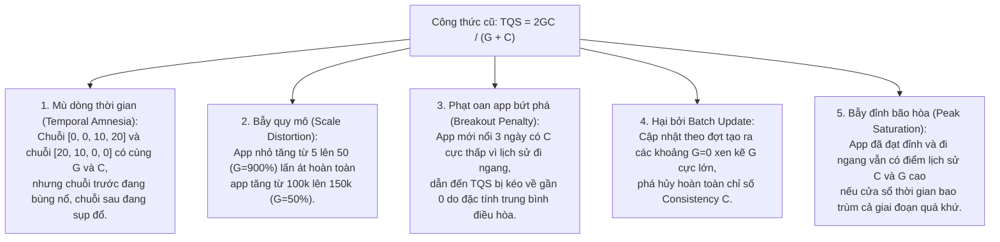
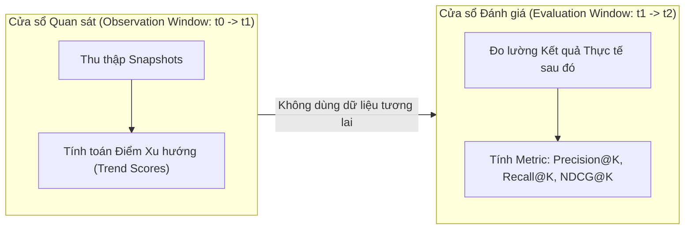
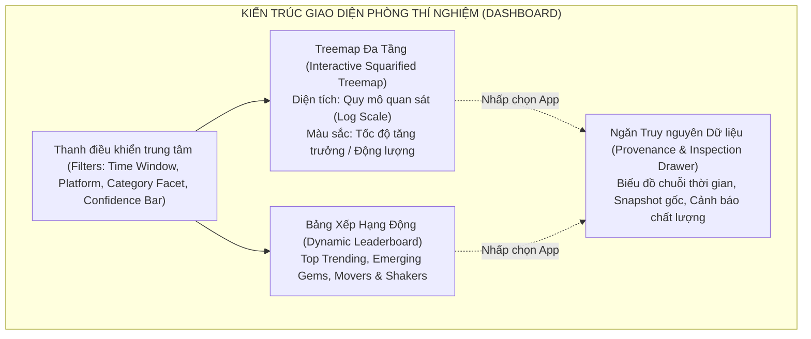
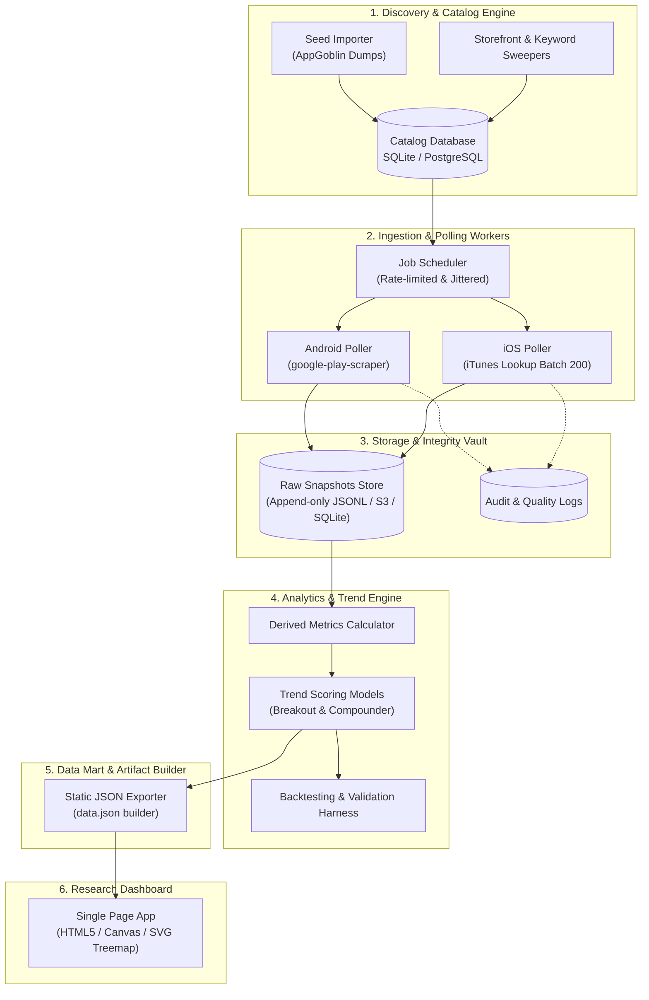
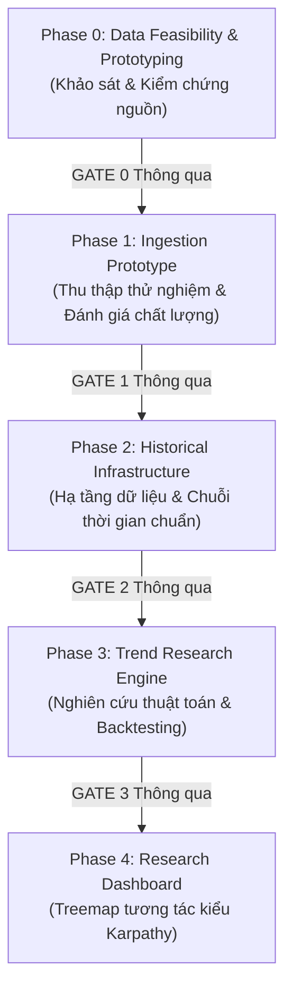
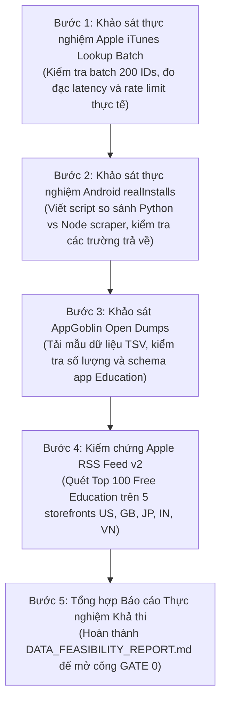

# ĐẶC TẢ DỰ ÁN HỆ THỐNG PHÁT HIỆN XU HƯỚNG ỨNG DỤNG GIÁO DỤC TOÀN CẦU
## (GLOBAL EDUCATION APP TREND DISCOVERY SYSTEM)

---

- **Mã tài liệu:** `SPEC-TRENDLAB-001`
- **Tình trạng:** `BẢN ĐẶC TẢ THIẾT KẾ CHÍNH THỨC (FOUNDATIONAL SPECIFICATION)`
- **Vai trò biên soạn:** Senior Software Architect, Data Engineer & Research Engineer
- **Phiên bản:** `1.0.0`
- **Ngày phát hành:** 12/11/2026
- **Tệp mục tiêu:** `PROJECT_SPECIFICATION.md`
- **Kế thừa & Thay thế:** Kế thừa các phân tích nền tảng từ `EDUCATION_VN_TREND_RESEARCH_BRIEF.md`, đồng thời hủy bỏ toàn bộ các giới hạn lỗi thời (không giới hạn thị trường Việt Nam, không giới hạn lựa chọn 3 ứng dụng, không thương mại hóa, loại bỏ công thức cảm tính chưa kiểm chứng).

---

## MỤC LỤC CHI TIẾT

1. [TỔNG QUAN ĐIỀU HÀNH (EXECUTIVE SUMMARY)](#1-tổng-quan-điều-hành-executive-summary)
2. [MỤC TIÊU VÀ PHẠM VI DỰ ÁN (PROJECT GOALS & NON-GOALS)](#2-mục-tiêu-và-phạm-vi-dự-án-project-goals--non-goals)
3. [CÁC YÊU CẦU ĐÃ XÁC NHẬN (CONFIRMED REQUIREMENTS)](#3-các-yêu-cầu-đã-xác-nhận-confirmed-requirements)
4. [PHẠM VI NGHIÊN CỨU VÀ DANH MỤC (RESEARCH SCOPE)](#4-phạm-vi-nghiên-cứu-và-danh-mục-research-scope)
5. [MA TRẬN KHẢ THI NGUỒN DỮ LIỆU (DATA SOURCE FEASIBILITY MATRIX)](#5-ma-trận-khả-thi-nguồn-dữ-liệu-data-source-feasibility-matrix)
6. [CHIẾN LƯỢC THU THẬP DỮ LIỆU (DATA COLLECTION STRATEGY)](#6-chiến-lược-thu-thập-dữ-liệu-data-collection-strategy)
7. [CHẤT LƯỢNG DỮ LIỆU VÀ NGUỒN GỐC (DATA QUALITY & PROVENANCE)](#7-chất-lượng-dữ-liệu-và-nguồn-gốc-data-quality--provenance)
8. [MÔ HÌNH DỮ LIỆU CHUẨN HÓA (DATA MODEL)](#8-mô-hình-dữ-liệu-chuẩn-hóa-data-model)
9. [NGHIÊN CỨU TOÁN HỌC VÀ CHỈ SỐ XU HƯỚNG (TREND METRICS & MATHEMATICAL RESEARCH)](#9-nghiên-cứu-toán-học-và-chỉ-số-xu-hướng-trend-metrics--mathematical-research)
10. [HẠN CHẾ VÀ BẪY THUẬT TOÁN (ALGORITHM LIMITATIONS & PITFALLS)](#10-hạn-chế-và-bẫy-thuật-toán-algorithm-limitations--pitfalls)
11. [CHIẾN LƯỢC KIỂM ĐỊNH VÀ BACKTESTING (BACKTESTING STRATEGY)](#11-chiến-lược-kiểm-định-và-backtesting-backtesting-strategy)
12. [NGUYÊN TẮC THIẾT KẾ TRỰC QUAN HÓA (DASHBOARD DESIGN PRINCIPLES)](#12-nguyên-tắc-thiết-kế-trực-quan-hóa-dashboard-design-principles)
13. [KIẾN TRÚC HỆ THỐNG TỔNG THỂ (SYSTEM ARCHITECTURE)](#13-kiến-trúc-hệ-thống-tổng-thể-system-architecture)
14. [CÁC GIAI ĐOẠN TRIỂN KHAI (IMPLEMENTATION PHASES)](#14-các-giai-đoạn-triển-khai-implementation-phases)
15. [TIÊU CHÍ NGHIỆM THU CHI TIẾT (ACCEPTANCE CRITERIA)](#15-tiêu-chí-nghiệm-thu-chi-tiết-acceptance-criteria)
16. [RỦI RO, GIỚI HẠN VÀ BIỆN PHÁP PHÒNG NGỪA (RISKS & CONSTRAINTS)](#16-rủi-ro-giới-hạn-và-biện-pháp-phòng-ngừa-risks--constraints)
17. [NHẬT KÝ QUYẾT ĐỊNH VÀ CÂU HỎI MỞ (OPEN QUESTIONS & DECISION LOG)](#17-nhật-ký-quyết-định-và-câu-hỏi-mở-open-questions--decision-log)
18. [TÀI LIỆU THAM KHẢO VÀ NGUỒN MINH CHỨNG (REFERENCES)](#18-tài-liệu-tham-khảo-và-nguồn-minh-chứng-references)
19. [QUY TẮC VẬN HÀNH DÀNH CHO CODING AGENT (AGENT OPERATING INSTRUCTIONS)](#19-quy-tắc-vận-hành-dành-cho-coding-agent-agent-operating-instructions)
20. [KẾ HOẠCH HÀNH ĐỘNG TIẾP THEO (NEXT ACTIONS — PHASE 0)](#20-kế-hoạch-hành-động-tiếp-theo-next-actions--phase-0)

---

## 1. TỔNG QUAN ĐIỀU HÀNH (EXECUTIVE SUMMARY)

Tài liệu này xác định kiến trúc kỹ thuật và phương pháp luận nghiên cứu cho hệ thống **Global Education App Trend Discovery** (tên mã nội bộ: `TrendLab`). Đây là một nền tảng nghiên cứu cá nhân chuyên sâu nhằm tự động hóa việc phát hiện, theo dõi và phân tích động lượng tăng trưởng của các ứng dụng di động thuộc danh mục Giáo dục (Education) chính thức trên **Google Play Store** và **Apple App Store** ở phạm vi **toàn cầu**.

### Triết lý cốt lõi
1. **Chất lượng dữ liệu và tính trung thực là tối thượng:** Hệ thống tuyệt đối không sử dụng các con số ước tính suy đoán (estimated downloads) không có căn cứ từ bên thứ ba làm nguồn đo lường chính. Dữ liệu phải được neo vào các quan sát thực nghiệm có nguồn gốc xuất xứ (provenance) và dấu thời gian (timestamp) không thể chối cãi.
2. **Khám phá ngọc thô (Uncovering Hidden Gems):** Mục tiêu trung tâm là phát hiện các ứng dụng đang có động lượng tăng trưởng bứt phá (emerging breakouts) khi chúng chưa lọt vào danh sách các ứng dụng hàng đầu thế giới, thay vì chỉ hiển thị lại các thương hiệu vốn đã quá phổ biến (như Duolingo, Photomath, Quizlet).
3. **Phân tách rạch ròi giữa Nền tảng và Tín hiệu:** Android và iOS có cơ chế phân phối, báo cáo và chỉ số công khai hoàn toàn khác nhau. Hệ thống không cộng gộp chỉ số thô giữa hai nền tảng mà phân tích song song theo từng tập tín hiệu đặc thù.
4. **Kiểm định chặt chẽ thay vì giả định cảm tính:** Mọi thuật toán xếp hạng, công thức xu hướng đều phải trải qua kiểm định lịch sử (backtesting) dạng walk-forward validation trước khi được đưa vào hiển thị.

---

## 2. MỤC TIÊU VÀ PHẠM VI DỰ ÁN (PROJECT GOALS & NON-GOALS)

### 2.1. Mục tiêu (Goals)
- **Thu thập tự động và bền bỉ:** Xây dựng quy trình tự động quét, định danh và lấy mẫu dữ liệu định kỳ của các ứng dụng thuộc danh mục Giáo dục trên cả hai cửa hàng ứng dụng lớn nhất thế giới.
- **Dữ liệu lịch sử chuẩn hóa:** Lưu trữ chuỗi thời gian (time-series snapshots) để tái hiện diễn biến và đo lường biến động qua các cửa sổ thời gian tùy chỉnh (7 ngày, 14 ngày, 30 ngày, 90 ngày, tùy chọn).
- **Phát hiện động lượng (Momentum & Breakout Detection):** Cung cấp các mô hình toán học nhằm tách biệt tín hiệu tăng trưởng thực chất khỏi các biến động nhiễu, cập nhật theo đợt (batch updates) và tính mùa vụ (seasonality).
- **Trực quan hóa khám phá đa chiều:** Cung cấp giao diện treemap tương tác mật độ cao (lấy cảm hứng từ công trình `karpathy.ai/jobs`), kết hợp bảng xếp hạng và biểu đồ chuỗi thời gian chi tiết.
- **Hỗ trợ quyết định nghiên cứu người dùng (UX/UI & Retention):** Cung cấp bộ lọc và hồ sơ dữ liệu minh bạch để nhà nghiên cứu tự do chọn lọc bất kỳ ứng dụng nào phục vụ phân tích chuyên sâu về sản phẩm.

### 2.2. Phi mục tiêu (Non-Goals)
- **KHÔNG làm công cụ thương mại:** Dự án phục vụ mục đích nghiên cứu cá nhân và hỗ trợ công việc nội bộ, không xây dựng hạ tầng multi-tenant SaaS, billing hay phân phối dữ liệu thương mại.
- **KHÔNG thu hẹp vào 3 ứng dụng định sẵn:** Hệ thống là một công cụ khám phá mở (discovery engine) trên toàn bộ không gian ứng dụng thu thập được. Việc phân tích 3 ứng dụng cụ thể là bài tập nghiên cứu độc lập ở hạ nguồn, không phải giới hạn của hệ thống này.
- **KHÔNG ước tính lượt tải bằng thuật toán hộp đen:** Không tự tạo ra con số tải hàng ngày giả định mà không có bằng chứng đo lường thực tế.
- **KHÔNG xâm nhập trái phép hoặc vượt rào kỹ thuật:** Không viết mã bẻ khóa CAPTCHA, không sử dụng mạng lưới botnet/proxy lậu để phá vỡ các giới hạn truy cập của nhà cung cấp.

---

## 3. CÁC YÊU CẦU ĐÃ XÁC NHẬN (CONFIRMED REQUIREMENTS)

Tất cả các thành viên phát triển và coding agent bắt buộc phải tuân thủ 13 điều khoản nền tảng đã được chốt:

1. `[CHỐT]` **Thị trường toàn cầu:** Hệ thống mở rộng phạm vi theo dõi toàn cầu, không còn giới hạn ở Việt Nam hay bất kỳ quốc gia đơn lẻ nào.
2. `[CHỐT]` **Đa nền tảng:** Hỗ trợ đồng thời cả hai nền tảng Android (Google Play) và iOS (Apple App Store).
3. `[CHỐT]` **Đúng danh mục chính thức:** Chỉ thu thập và nghiên cứu các ứng dụng được phân loại chính thức vào danh mục Education (hoặc danh mục con tương đương) trên từng cửa hàng.
4. `[CHỐT]` **Cửa sổ thời gian linh hoạt:** Mọi chỉ số xu hướng phải có khả năng tính toán trên các khoảng thời gian tùy biến do người dùng thiết lập ($T_1 \to T_2$).
5. `[CHỐT]` **Ưu tiên dữ liệu quan sát trực tiếp:** Không dùng dữ liệu estimated downloads làm căn cứ chính. Mọi phép đo phải bắt nguồn từ các trường dữ liệu quan sát được (observed counters, rating counts, rankings, review velocity).
6. `[CHỐT]` **Lưu trữ lịch sử dài hạn:** Thiết kế lưu trữ dạng chuỗi thời gian bất biến (immutable snapshots) phục vụ backtesting và phân tích hồi quy.
7. `[CHỐT]` **Cân bằng giữa bao phủ, độ mới và chi phí:** Tối ưu hóa pipeline để đạt độ bao phủ lớn nhất trong điều kiện chi phí hạ tầng thấp nhất (ưu tiên giải pháp zero-cost / low-cost).
8. `[CHỐT]` **Tôn trọng giới hạn nguồn:** Không tự giả định các nguồn miễn phí là không giới hạn. Mọi pipeline phải cài đặt cơ chế kiểm soát tần suất gọi (rate-limiting), exponential backoff và ngắt mạch (circuit breaker).
9. `[CHỐT]` **Thuật toán chưa chốt:** Công thức xếp hạng và phát hiện xu hướng hiện tại chỉ là giả thuyết nghiên cứu. Không được hard-code bất kỳ công thức nào thành sự thật tuyệt đối.
10. `[CHỐT]` **Không cộng gộp cơ học Android & iOS:** Điểm số và chỉ số của Android và iOS phải được giữ độc lập hoặc chuẩn hóa bằng phương pháp thống kê có kiểm định trước khi tổng hợp.
11. `[CHỐT]` **Minh bạch xuất xứ (Provenance):** Mỗi điểm dữ liệu hiển thị phải truy vết được: lấy từ đâu, thời điểm nào, bằng công cụ gì và mức độ tin cậy ra sao.
12. `[CHỐT]` **Dữ liệu thực quan trọng hơn UI:** Giao diện trực quan chỉ có giá trị khi dữ liệu phía sau là dữ liệu sạch, cập nhật và trung thực.
13. `[CHỐT]` **Hỗ trợ kiểm định thuật toán:** Hệ thống phải tích hợp sẵn môi trường backtesting (walk-forward evaluation) để so sánh định lượng giữa các giả thuyết thuật toán.

---

## 4. PHẠM VI NGHIÊN CỨU VÀ DANH MỤC (RESEARCH SCOPE)

### 4.1. Định nghĩa Danh mục Education trên hai nền tảng
- **Google Play Store:**
  - Danh mục chính thức: `EDUCATION` (Genre ID: `EDUCATION`).
  - Danh mục liên quan cần lưu ý: `FAMILY_EDUCATION` (dành cho trẻ em dưới danh mục Family).
  - Quy tắc lọc: Chỉ tiếp nhận các ứng dụng có trường `genreId` hoặc `categories` chứa `EDUCATION`.
- **Apple App Store:**
  - Genre ID chính thức: `6017` (Education).
  - Phân loại Apple cho phép: `primaryGenreId` và danh sách `genreIds`.
  - Quy tắc lọc: Ứng dụng phải có `primaryGenreId == 6017` hoặc `6017` nằm trong danh sách genres chính thức.

### 4.2. Chiến lược bao phủ Storefront toàn cầu
Do Apple App Store và Google Play quản lý nội dung theo từng quốc gia (storefront / territory), việc nghiên cứu toàn cầu đòi hỏi phân tầng hợp lý để tránh bùng nổ số lượng request:

| Tầng (Tier) | Danh sách Storefront tiêu biểu | Mục đích nghiên cứu | Tần suất quét khuyến nghị |
| :--- | :--- | :--- | :--- |
| **Tier 1 (Anchor Markets)** | US, GB, DE, JP, KR | Các thị trường chi tiêu cao, định hình công nghệ giáo dục toàn cầu. | Hàng ngày (Daily) |
| **Tier 2 (High Velocity Markets)** | IN, BR, ID, VN, MX, PH | Các thị trường có khối lượng tải và tốc độ tăng trưởng người dùng bùng nổ. | Hàng ngày hoặc 2 ngày/lần |
| **Tier 3 (Long Tail Markets)** | Các quốc gia còn lại (150+ storefronts) | Khảo sát độ phủ toàn cầu thông qua tập dữ liệu tĩnh hoặc quét tuần tự thưa. | Hàng tuần / Hàng tháng |

---

## 5. MA TRẬN KHẢ THI NGUỒN DỮ LIỆU (DATA SOURCE FEASIBILITY MATRIX)

Bảng tổng hợp chi tiết hiện trạng kỹ thuật, tính hợp pháp và khả năng khai thác của tất cả các nguồn dữ liệu tiềm năng:

| Nguồn dữ liệu | Phân loại API | Bản chất dữ liệu | Các trường dữ liệu cốt lõi | Dữ liệu lịch sử | Tần suất cập nhật thực tế | Giới hạn & Rate Limit thực tế | Khả năng Batch | Độ bao phủ | Rủi ro kỹ thuật & Chặn IP | Nguồn tài liệu chứng minh |
| :--- | :--- | :--- | :--- | :--- | :--- | :--- | :--- | :--- | :--- | :--- |
| **Google Play (Direct Web Scraping)** | Phi chính thức (HTML / Web internal) | Quan sát trực tiếp | `appId`, `title`, `developer`, `score`, `ratings`, `reviews`, `installs`, `minInstalls`, `maxInstalls`, `realInstalls`, `updated` | Không có sẵn (phải tự lưu) | ~24h - 72h tùy ứng dụng | Không công bố; Google chặn bằng HTTP 429/CAPTCHA nếu request nhanh. | Không hỗ trợ batch chính thức | Rất lớn (~2M+ apps) | Rất cao: Cấu trúc HTML/JSON internal (`AF_initDataCallback`) thay đổi liên tục; IP datacenter dễ bị chặn | [Google Play Web](https://play.google.com/store/apps) |
| **Apple App Store (Direct Web Scraping)** | Phi chính thức (HTML) | Quan sát trực tiếp | `id`, `name`, `developer`, `price`, `description`, `currentVersionReviews` | Không có sẵn | ~24h - 48h | Không công bố; HTTP 429 nếu gọi dồn dập | Không hỗ trợ | Rất lớn (~1.8M+ apps) | Cao: Thay đổi layout web định kỳ; chặn IP scraper | [Apple App Store Web](https://apps.apple.com) |
| **Apple iTunes Search / Lookup API** | **Chính thức** (Public REST API) | Quan sát trực tiếp | `trackId`, `bundleId`, `trackName`, `artistName`, `userRatingCount`, `averageUserRating`, `primaryGenreId`, `genres`, `price`, `version`, `releaseDate` | Không có lịch sử | Thời gian thực (cache CDN ~1h - 2h) | **~20 calls/phút/IP**. Vượt quá sẽ nhận HTTP 403 / 429 | Hỗ trợ Lookup tối đa **200 ID/request** qua param `id=id1,id2,...` | Toàn bộ ứng dụng active trên App Store | Thấp: API công khai, ổn định cao, không đổi schema đột ngột | [Apple Affiliate Search API Doc](https://developer.apple.com/library/archive/documentation/AudioVideo/Conceptual/iTuneSearchAPI/index.html) |
| **Apple RSS Marketing Tools API** | **Chính thức** (Public Feed API v2) | Quan sát trực tiếp (Thứ hạng bảng xếp hạng) | `id`, `name`, `artistName`, `artworkUrl100`, `url`, thứ hạng vị trí (vị trí index trong mảng) | Không có lịch sử | Cập nhật định kỳ vài giờ/lần | Nhẹ nhàng, cache tốt; giới hạn tối đa **100 apps/feed** | Trả về 1 mảng 10-100 apps trong 1 request | Chỉ bao phủ Top Apps (Top 100 Free/Paid) | Rất thấp: Cực kỳ ổn định, thiết kế cho widget công khai | [Apple RSS Marketing Tools](https://rss.applemarketingtools.com/) |
| **`google-play-scraper` (Node.js - facundoolano)** | Thư viện mã nguồn mở | Bóc tách từ Google Play internal payload | Toàn bộ metadata, bao gồm `realInstalls`, `score`, `ratings`, `histogram`, `reviews` | Không (client-side) | Phụ thuộc Google Play | Bị ràng buộc bởi IP thực thi | Hỗ trợ hàm `.app()`, `.list()`, `.developer()` | Bất kỳ app nào có URL hợp lệ | Trung bình - Cao: Phụ thuộc vào việc tác giả cập nhật regex khi Google đổi cấu trúc | [GitHub: facundoolano/google-play-scraper](https://github.com/facundoolano/google-play-scraper) |
| **`google-play-scraper` (Python - JoMingyu)** | Thư viện mã nguồn mở | Bóc tách tương tự bản Node.js | Giống bản Node.js: `realInstalls`, `ratings`, `score`, `histogram` | Không (client-side) | Phụ thuộc Google Play | Bị ràng buộc bởi IP thực thi | Cho phép duyệt pagination danh mục và tìm kiếm | Bất kỳ app nào tìm được | Trung bình - Cao: Tương tự bản Node.js, cần kiểm tra cập nhật thường xuyên | [GitHub: JoMingyu/google-play-scraper](https://github.com/JoMingyu/google-play-scraper) |
| **`app-store-scraper` (Node.js - facundoolano / perttu)** | Thư viện mã nguồn mở | Bóc tách iTunes API & Web frontend | `id`, `appId`, `title`, `score`, `reviews`, `ratings` (histogram khi bật flag), `genreId` | Không (client-side) | Phụ thuộc App Store | Bị ràng buộc bởi IP thực thi | Có hàm `.list()`, `.search()`, `.reviews()` | Mọi app có ID | Trung bình: Apple ít đổi endpoint iTunes nhưng thắt chặt rate limit | [GitHub: facundoolano/app-store-scraper](https://github.com/facundoolano/app-store-scraper) |
| **AppGoblin REST API** | Nền tảng Open Intelligence | Dữ liệu quét từ crawler riêng (`adscrawler`) | Metadata, SDKs, ad networks, tracking components, lịch sử xếp hạng | Có lưu trữ lịch sử xếp hạng và metadata | Quét định kỳ tuần/tháng | Cần API Token; có rate limit theo tài khoản | Hỗ trợ truy vấn REST đơn lẻ | Hàng triệu app Android & iOS | Thấp: API có cấu trúc rõ ràng, hỗ trợ cả Model Context Protocol (MCP) | [AppGoblin Developer Documentation](https://appgoblin.info/) |
| **AppGoblin Public Datasets** | Bộ dữ liệu mở (Open Data Dumps) | Tổng hợp định kỳ từ crawler | `store_apps.tsv.xz`, danh sách package ID, app ID, nhà phát triển, danh mục, thời điểm quét | Snapshot tĩnh theo mốc phát hành | Cập nhật định kỳ theo release | Tải file nén tĩnh (không rate limit API) | File dung lượng lớn chứa hàng triệu bản ghi | Hàng triệu ứng dụng | Rất thấp: File tĩnh lưu trên server/GitHub | [AppGoblin GitHub Dumps](https://github.com/appgoblin-dev) |

---

## 6. CHIẾN LƯỢC THU THẬP DỮ LIỆU (DATA COLLECTION STRATEGY)

Để giải quyết bài toán cốt lõi: **Không thể phụ thuộc vào một nguồn duy nhất và không được vi phạm rate limit**, kiến trúc thu thập được thiết kế theo mô hình **Đa tầng kết hợp (Hybrid Ingestion Pipeline)**.

### 6.1. Discovery Pipeline (Đột phá bài toán vượt ra ngoài Top Charts)
Nếu chỉ cào Top Charts, hệ thống sẽ rơi vào cái bẫy **chỉ thấy app đã nổi tiếng**. Để tìm "ngọc thô", Discovery Layer áp dụng 4 cơ chế:
1. **Bulk Seed Ingestion:** Tải định kỳ dataset `store_apps.tsv.xz` từ AppGoblin để nạp vào hệ thống hàng chục nghìn Package ID và iOS App ID thuộc danh mục Education.
2. **Apple RSS Multi-Storefront Sweep:** Thu thập Top 100 Education của 30+ storefronts trọng điểm. Một ứng dụng có thể chưa lọt top tại Mỹ nhưng đang bứt phá tại Brazil hay Ấn Độ.
3. **Developer Expansion:** Khi phát hiện một ứng dụng giáo dục tiềm năng, tự động truy vấn danh sách tất cả các ứng dụng khác của cùng nhà phát triển đó (`developerId` trên Google Play, `artistId` trên Apple).
4. **Keyword Permutation Sweeps:** Sử dụng tập từ khóa giáo dục chuyên ngành (STEM, phonics, flashcard, SAT prep, coding for kids, LMS, v.v.) quét sâu theo tuần tự để định danh các ứng dụng mới ra mắt.

### 6.2. Snapshot Scheduling & Polling Engine
- **iOS Collection:**
  - **Batch Lookup tối đa 200 ID:** Sử dụng iTunes Lookup API với query string `id=id_1,id_2,...,id_200`. Với giới hạn ~20 calls/phút, một luồng duy nhất có thể quét tới **4.000 apps/phút** (240.000 apps/giờ) mà hoàn toàn hợp lệ và không bị chặn.
  - **RSS Ranking Polling:** Quét bảng xếp hạng Education hàng ngày từ RSS Marketing Tools v2 để ghi nhận biến động vị trí Top 100.
- **Android Collection:**
  - **Thực thi phân tán có kiểm soát nhịp:** Sử dụng `google-play-scraper` với cơ chế điều tiết (Throttling: tối thiểu 1.500ms - 3.000ms giữa các request trên mỗi worker, bổ sung random jitter ±500ms).
  - Phân tầng tần suất (Adaptive Polling):
    - Nhóm A (Đang có biến động mạnh hoặc rank cao): Quét 24 giờ/lần.
    - Nhóm B (Bình thường / Ổn định): Quét 72 giờ/lần.
    - Nhóm C (Không biến động qua 30 ngày): Quét 7 ngày/lần.

### 6.3. Quy tắc Đạo đức và Ranh giới Kỹ thuật (Scraping Boundaries)
- `[CHỐT]` **Tôn trọng mã phản hồi HTTP:** Gặp `429 Too Many Requests` hoặc `403 Forbidden` phải lập tức kích hoạt Exponential Backoff (chờ $2^n$ giây) và tạm dừng worker, tuyệt đối không spam request liên tục.
- `[CHỐT]` **Tuyệt đối không giải CAPTCHA:** Khi một endpoint kích hoạt CAPTCHA, worker phải dừng lại, ghi nhận trạng thái `BLOCKED` và báo cáo cho quản trị viên, không sử dụng các dịch vụ bên thứ ba để bypass.
- `[CHỐT]` **Header minh bạch:** Thiết lập `User-Agent` rõ ràng, không giả lập dấu vân tay trình duyệt độc hại.

---

## 7. CHẤT LƯỢNG DỮ LIỆU VÀ NGUỒN GỐC (DATA QUALITY & PROVENANCE)

### 7.1. Phân loại 3 tầng dữ liệu
Hệ thống thiết lập ranh giới bất khả xâm phạm giữa 3 tầng dữ liệu:
1. **Tầng 1: Dữ liệu thô (Raw Snapshots):** Bản sao nguyên vẹn của JSON/HTML payload nhận được từ nguồn, gắn liền với URL, thời điểm nhận và mã băm SHA-256. Không được chỉnh sửa dưới bất kỳ hình thức nào.
2. **Tầng 2: Dữ liệu dẫn xuất (Derived Metrics):** Các đại lượng được tính toán tất định (deterministic) từ chuỗi snapshot thô (ví dụ: $\Delta \text{observed\_installs}$, $\Delta \text{ratings}$, số ngày xuất hiện trong bảng xếp hạng).
3. **Tầng 3: Kết quả mô hình (Model Scores):** Các chỉ số tổng hợp, điểm động lượng, phân vị xếp hạng sinh ra từ các thuật toán thử nghiệm.

### 7.2. Xử lý các biến cố thực tế của vòng đời ứng dụng
- **App bị gỡ khỏi store (Delisted / 404):** Không xóa bản ghi lịch sử. Đánh dấu trạng thái `app_status = DELISTED` kèm mốc thời gian phát hiện.
- **App đổi danh mục (Category Drift):** Nếu app chuyển từ Education sang Games, hệ thống ghi nhận sự kiện chuyển dịch và tạm ngưng đưa app vào bảng xếp hạng Education mới, nhưng giữ nguyên chuỗi lịch sử cũ.
- **App đổi nhà phát triển hoặc tên gọi:** Lưu vết lịch sử thay đổi trong bảng audit log.
- **Ứng dụng đa nền tảng (Cross-platform Resolution):** Tuyệt đối không tự động gộp 2 ứng dụng Android và iOS chỉ vì trùng tên hiển thị. Hệ thống chỉ liên kết dưới một thực thể `Canonical App` khi:
  - Khớp tên miền trang chủ chính thức (`website_url`).
  - Hoặc có liên kết chéo rõ ràng trong mô tả hoặc metadata nhà phát triển.
  - Trường hợp còn nghi ngờ, giữ độc lập và gán cờ `linkage_confidence < 1.0`.

---

## 8. MÔ HÌNH DỮ LIỆU CHUẨN HÓA (DATA MODEL)

Mô hình dữ liệu được thiết kế tối ưu cho truy vấn chuỗi thời gian phân tích, hỗ trợ audit và backtesting:

---

## 9. NGHIÊN CỨU TOÁN HỌC VÀ CHỈ SỐ XU HƯỚNG (TREND METRICS & MATHEMATICAL RESEARCH)

### 9.1. Phân tích thực nghiệm Android `realInstalls`
Để giải quyết dứt điểm vấn đề gây tranh cãi về `realInstalls`, hệ thống áp dụng bộ định nghĩa trung lập và giao thức kiểm chứng khoa học:

#### Phân biệt 3 khái niệm:
1. `observed_install_counter` ($I_t$): Số nguyên thô đọc được từ Google Play tại thời điểm $t$.
2. `observed_install_delta` ($\Delta I = I_{t_2} - I_{t_1}$): Hiệu số giữa hai snapshot quan sát.
3. $\text{Actual New Installs}$ ($D_{true}$): Tổng lượt cài đặt mới thực tế phát sinh trong khoảng thời gian.

> [!WARNING]
> Tuyệt đối không xem $\Delta I$ tương đương với $D_{true}$ hàng ngày khi chưa qua kiểm định, vì Google Play có thể cập nhật bộ đếm theo đợt (batch sync) hoặc thực hiện thuật toán trừ lượt cài ảo/gỡ cài đặt định kỳ.

#### Kế hoạch thực nghiệm 7 bước cho Android:
1. **Kiểm tra tính đơn điệu (Monotonicity Test):** Ghi nhận liệu $I_{t+1} < I_t$ có xảy ra không? Nếu có, tần suất bao nhiêu và thuộc nhóm app nào?
2. **Kiểm tra nhịp đồng bộ (Batch Update Detection):** Đếm số ngày liên tiếp $\Delta I = 0$, sau đó xuất hiện bước nhảy lớn dạng bậc thang (staircase pattern).
3. **Kiểm tra tính cục bộ theo Storefront:** Gọi đồng thời `country='us'`, `country='vn'`, `country='in'` cho cùng một `appId`. Liệu $I_t$ trả về giống nhau hoàn toàn hay phản ánh lượt tải riêng của từng thị trường?
4. **Kiểm tra độ đồng thuận thư viện (Cross-library Parity):** So sánh giá trị trả về giữa `google-play-scraper` (Python) và `google-play-scraper` (Node.js) trên cùng tập mẫu tại cùng thời điểm.
5. **Kiểm tra độ trễ (Latency Test):** Đối chiếu ngày cập nhật hiển thị trên store (`updated`) với thời điểm bước nhảy của $I_t$.
6. **Kiểm tra khả năng suy luận xu hướng trên cửa sổ dài:** Đánh giá xem trên khoảng thời gian đủ dài ($\ge 30$ ngày), hiệu số $\Delta I_{30d}$ có phản ánh chính xác xu hướng mở rộng quy mô người dùng hay không.
7. **Quy tắc làm mịn (Smoothing & Outlier Handling):** Nếu phát hiện cập nhật theo đợt, áp dụng kỹ thuật Kernel Regression hoặc Moving Average trên cửa sổ 7 ngày để tránh đột biến giả tạo.

---

### 9.2. Phương pháp luận Tín hiệu iOS (Không có Install Counter)
Apple App Store không cung cấp công khai bất kỳ bộ đếm cài đặt nào cho đối thủ cạnh tranh. Mọi nỗ lực "ước tính" lượt tải iOS bằng công thức nội suy đều thiếu cơ sở khoa học. Do đó, hệ thống tập trung vào **3 trụ cột tín hiệu quan sát trực tiếp**:

#### Trụ cột 1: Rating Velocity & Volume ($\Delta R / \Delta t$)
$$\text{Rating Velocity}_{T} = \frac{R(t_2) - R(t_1)}{t_2 - t_1}$$
Trong đó $R(t)$ là tổng số lượt đánh giá ghi nhận tại thời điểm $t$.
- *Bảo đảm thống kê:* Người dùng chỉ đánh giá khi đang sử dụng app. Tốc độ tăng trưởng đánh giá là đại diện (proxy) có độ trễ nhưng đáng tin cậy cho mức độ tương tác người dùng tích cực.
- *Lưu ý sai lệch:* Cần loại trừ tác động của việc app tung ra pop-up xin đánh giá dồn dập (SKStoreReviewController) bằng cách kiểm tra tương quan với nội dung review text.

#### Trụ cột 2: Storefront Presence & Breadth
Một ứng dụng giáo dục chất lượng cao thường mở rộng ra nhiều quốc gia.
$$\text{Storefront Presence Score} = \sum_{s \in \mathcal{S}} w_s \cdot \mathbb{I}(\text{app xuất hiện trong Top Charts của } s)$$
Trong đó $\mathcal{S}$ là tập hợp các storefront khảo sát, $w_s$ là trọng số quy mô thị trường của storefront $s$ (dựa trên dân số hoặc quy mô thị trường di động công bố bởi ITU/World Bank), $\mathbb{I}$ là hàm chỉ thị.

#### Trụ cột 3: Rank Momentum không cộng gộp cơ học
Tuyệt đối không lấy trung bình cộng thứ hạng của các quốc gia:
$$\text{Sai lầm:} \quad \overline{\text{Rank}} = \frac{\text{Rank}_{\text{US}} + \text{Rank}_{\text{Tuvalu}}}{2}$$
Thay vào đó, hệ thống chuẩn hóa bằng **Thứ hạng phân vị có trọng số (Weighted Percentile Rank)**:
$$\text{Rank Score}_s(t) = \frac{\text{MaxRank} - \text{Rank}_s(t) + 1}{\text{MaxRank}}$$
$$\text{Aggregated Rank Momentum} = \sum_{s} w_s \cdot \left[ \text{Rank Score}_s(t_2) - \text{Rank Score}_s(t_1) \right]$$
Trường hợp app không xuất hiện trong bảng xếp hạng Top $K$, gán mặc định $\text{Rank Score} = 0$.

---

### 9.3. Danh mục các chỉ số toán học phân tích xu hướng

Hệ thống định nghĩa bảng chỉ số ứng viên độc lập, phân tích rõ công thức, ý nghĩa và mức độ trùng lặp thông tin:

| Tên chỉ số | Ký hiệu | Công thức toán học đề xuất | Ý nghĩa & Bản chất | Rủi ro / Bẫy dữ liệu |
| :--- | :--- | :--- | :--- | :--- |
| **Absolute Growth** | $G_{abs}$ | $X(t_2) - X(t_1)$ | Đo lường quy mô mở rộng thực tế về mặt số lượng tuyệt đối. | Thiên vị tuyệt đối cho các app khổng lồ; app nhỏ tăng gấp 10 lần vẫn có $G_{abs}$ rất thấp. |
| **Relative Growth** | $G_{rel}$ | $\frac{X(t_2) - X(t_1)}{X(t_1) + \epsilon}$ | Đo lường tỷ lệ phần trăm mở rộng so với quy mô ban đầu. | Thiên vị cực đoan cho app nhỏ (từ 1 lên 10 lượt đánh giá là tăng 900%). |
| **Dampened Growth (Bayesian Shrinkage)** | $G_{damp}$ | $\frac{X(t_2) - X(t_1)}{X(t_1) + K_{prior}}$ | Cân bằng giữa tuyệt đối và tương đối bằng tham số làm mịn $K_{prior}$. | Phải kiểm định thực nghiệm để chọn $K_{prior}$ tối ưu cho từng nền tảng. |
| **Velocity Momentum** | $M_{vel}$ | $\text{EMA}_{\text{short}}(\Delta X) - \text{EMA}_{\text{long}}(\Delta X)$ | Đo lường sự phân kỳ của tốc độ gần đây so với tốc độ trung hạn (tương tự MACD). | Nhạy cảm với nhiễu dữ liệu nếu snapshot bị thiếu ngày. |
| **Acceleration** | $A$ | $\frac{\Delta X(t_2) - \Delta X(t_1)}{t_2 - t_1}$ | Đạo hàm bậc hai; đo lường sự tăng tốc hoặc giảm tốc của dòng người dùng. | Dữ liệu cập nhật theo đợt sẽ tạo ra gia tốc âm hoặc dương giả tạo cực lớn. |
| **Persistence / Consistency** | $C_{pers}$ | $\frac{1}{N} \sum_{i=1}^N \mathbb{I}(\Delta X_i > 0)$ | Tỷ lệ số khoảng thời gian ghi nhận mức tăng dương trong cửa sổ quan sát. | Phạt oan các app vừa mới bùng nổ trong 3 ngày qua (vì lịch sử trước đó đi ngang). |
| **Trend Linearity (Theil-Sen)** | $\beta_{TS}$ | $\text{median}\left( \frac{X_j - X_i}{t_j - t_i} \right)$ | Hệ số góc hồi quy phi tham số, chống chịu cực tốt với ngoại lai (outliers). | Chi phí tính toán $O(N^2)$, cần lấy mẫu tối ưu cho chuỗi dài. |
| **Volatility** | $\sigma_{rel}$ | $\frac{\text{std}(\Delta X)}{\text{mean}(\Delta X) + \epsilon}$ | Hệ số biến thiên; đo lường mức độ giật cục, thiếu ổn định của chuỗi dữ liệu. | Có thể phạt nhầm các ứng dụng tăng trưởng theo từng đợt marketing chính đáng. |
| **Drawdown** | $DD_{max}$ | $\frac{\max_{\tau \le t} X(\tau) - X(t)}{\max_{\tau \le t} X(\tau) + \epsilon}$ | Độ sụt giảm tối đa từ đỉnh gần nhất; đo lường nguy cơ thoái trào. | Không phân biệt được suy thoái tự nhiên sau mùa thi hay app bị người dùng tẩy chay. |
| **Observation Completeness** | $Q_{comp}$ | $\frac{\text{Số ngày có snapshot thực tế}}{\text{Số ngày dự kiến của cửa sổ}}$ | Chỉ số kiểm soát chất lượng; phạt điểm các app thiếu dữ liệu hoặc gián đoạn. | Tránh việc mô hình đưa ra điểm cao cho một app chỉ có 2 điểm dữ liệu snapshot. |
| **Freshness Factor** | $\phi_{fresh}$ | $\exp\left( -\lambda \cdot (t_{now} - t_{last\_seen}) \right)$ | Hệ số suy giảm theo thời gian; app ngừng cập nhật dữ liệu sẽ bị trừ điểm dần. | Đảm bảo dashboard luôn ưu tiên các xu hướng đang diễn ra ở hiện tại. |

---

### 9.4. Hai chế độ phân tích xu hướng đề xuất

Thay vì ép buộc một công thức duy nhất, hệ thống phân tách thành hai chế độ phân tích chuyên biệt:

#### Chế độ A: Phát hiện Ngọc thô bứt phá (Emerging Breakout Trends)
- **Mục tiêu:** Phát hiện các ứng dụng giáo dục mới ra mắt hoặc quy mô vừa và nhỏ nhưng có sự đột biến mãnh liệt về tốc độ đánh giá, thứ hạng category và lượt cài đặt quan sát.
- **Tập trung vào:** Gia tốc ($A$), Phân kỳ động lượng ($M_{vel}$), Relative Growth có kiểm soát ($G_{damp}$), Độ phủ storefront mới mở rộng.
- **Chấp nhận:** Độ ổn định lịch sử thấp hơn, dung sai rủi ro cao hơn.

#### Chế độ B: Tăng trưởng Bền vững (Sustained Compounders)
- **Mục tiêu:** Nhận diện các ứng dụng duy trì được sự tăng trưởng liên tục, ổn định qua nhiều tháng mà không bị sụt giảm mạnh.
- **Tập trung vào:** Độ bền bỉ ($C_{pers}$), Hệ số góc hồi quy Theil-Sen ($\beta_{TS}$), Tỷ lệ sụt giảm thấp ($DD_{max} < 15\%$), Chất lượng dữ liệu cao ($Q_{comp} \ge 95\%$).

---

## 10. HẠN CHẾ VÀ BẪY THUẬT TOÁN (ALGORITHM LIMITATIONS & PITFALLS)

### 10.1. Mổ xẻ toàn diện công thức sơ khai `TQS = 2GC / (G + C)`
Trong tài liệu nghiên cứu trước đây (`EDUCATION_VN_TREND_RESEARCH_BRIEF.md`), công thức trung bình điều hòa giữa Growth ($G$) và Consistency ($C$) từng được xem xét. Đây là một giả thuyết có nhiều khiếm khuyết toán học nghiêm trọng:

### 10.2. Tính mùa vụ đặc thù của ngành Giáo dục (Education Seasonality)
- Danh mục Giáo dục có chu kỳ dao động cực đoan nhất trong các ngành ứng dụng di động:
  - **Đỉnh cao (Surge):** Mùa tựu trường (Tháng 8 - Tháng 9) và Mùa thi học kỳ/tốt nghiệp (Tháng 5 - Tháng 6).
  - **Đáy sâu (Slump):** Kỳ nghỉ hè (Tháng 7) và các kỳ nghỉ lễ dài ngày.
- **Giải pháp xử lý:** Khi đánh giá một app tăng vọt vào tháng 9, thuật toán phải đối chiếu với mức tăng trung bình toàn ngành (Category Baseline Detrending) để xác định xem app đó tăng do xu hướng nội tại hay chỉ đơn thuần hưởng lợi từ tính mùa vụ chung.

---

## 11. CHIẾN LƯỢC KIỂM ĐỊNH VÀ BACKTESTING (BACKTESTING STRATEGY)

Để đảm bảo không có bất kỳ nhận định chủ quan nào được đưa vào production, hệ thống bắt buộc tích hợp quy trình kiểm định **Walk-Forward Validation**:

### 11.1. Khung kiểm nghiệm Walk-Forward
- **Nguyên tắc vàng:** Tuyệt đối không để lộ dữ liệu tương lai (No Lookahead Bias). Điểm xu hướng tại ngày $t_1$ chỉ được phép sử dụng dữ liệu ghi nhận trước hoặc đúng vào ngày $t_1$.
- **Cửa sổ trượt (Rolling Windows):**
  - Observation Window: 30 ngày (dùng để sinh tín hiệu xếp hạng).
  - Holdout / Evaluation Window: 14 ngày tiếp theo (dùng để kiểm tra xem app được gắn nhãn "xu hướng" có thực sự tiếp tục mở rộng quy mô hay duy trì thứ hạng không).

### 11.2. Thử nghiệm so sánh đa mô hình (Model Tournament)
Hệ thống sẽ chạy song song ít nhất 4 biến thể thuật toán trên cùng tập dữ liệu lịch sử:
- **Model A (Baseline):** Xếp hạng thuần túy theo Tăng trưởng Tuyệt đối ($G_{abs}$).
- **Model B (Growth + Persistence):** Kết hợp Dampened Growth ($G_{damp}$) và Tỷ lệ phiên tăng dương ($C_{pers}$).
- **Model C (Momentum Enhanced):** Bổ sung Velocity Momentum ($M_{vel}$) và Gia tốc ($A$).
- **Model D (Multi-Signal Composite):** Kết hợp Model C với Storefront Presence và Borda Rank Momentum.

### 11.3. Các chỉ số đo lường hiệu năng thuật toán
1. **Precision@K:** Trong Top $K$ ứng dụng được mô hình dự đoán là xu hướng bứt phá, có bao nhiêu phần trăm ứng dụng thực sự tăng trưởng tiếp tục trong Evaluation Window?
2. **Recall@K:** Mô hình bắt được bao nhiêu phần trăm trong tổng số tất cả các ứng dụng có mức tăng trưởng top đầu của thị trường?
3. **NDCG@K (Normalized Discounted Cumulative Gain):** Đánh giá chất lượng của thứ tự xếp hạng (app tăng mạnh nhất có được xếp ở vị trí số 1 không?).
4. **False Discovery Rate (FDR):** Tỷ lệ báo động giả (dự đoán bứt phá nhưng ngay sau đó đi ngang hoặc giảm mạnh).
5. **Lead Time (Thời gian cảnh báo sớm):** Mô hình phát hiện ra ứng dụng trước khi nó xuất hiện trên Top Charts chính thức bao nhiêu ngày?

> [!IMPORTANT]
> Nếu hệ thống chưa tích lũy đủ chu kỳ dữ liệu lịch sử tối thiểu (ít nhất 60 - 90 ngày snapshots liên tục), coding agent **không được phép kết luận bất kỳ mô hình nào là tốt nhất**. Mọi hiển thị phải đi kèm nhãn `[EXPERIMENTAL / UNVALIDATED]`.

---

## 12. NGUYÊN TẮC THIẾT KẾ TRỰC QUAN HÓA (DASHBOARD DESIGN PRINCIPLES)

Giao diện nghiên cứu lấy cảm hứng trực tiếp từ kiến trúc của **Andrej Karpathy** trên `karpathy.ai/jobs` ([GitHub: karpathy/jobs](https://github.com/karpathy/jobs)): **Tối giản, mật độ thông tin cao, kết xuất từ dữ liệu tĩnh (pre-computed data artifacts), không phụ thuộc vào backend phức tạp khi hiển thị.**

### 12.1. Quy tắc Ngữ nghĩa của Treemap (Kích thước & Màu sắc)
Tránh hoàn toàn các hiểu lầm thị giác bằng định nghĩa minh bạch:
- **Diện tích hình chữ nhật (Tile Area):**
  - Thể hiện **Quy mô quan sát được (Observed Volume Scale)**, cụ thể là $\log_{10}(\text{observed\_install\_counter} + 1)$ đối với Android hoặc $\log_{10}(\text{total\_ratings} + 1)$ đối với iOS.
  - `[CHỐT]` Tuyệt đối **KHÔNG** tuyên bố diện tích là "Thị phần" (Market Share), vì không có cơ sở dữ liệu về tổng lượt cài toàn cầu.
- **Màu sắc hình chữ nhật (Tile Color):**
  - Cho phép người dùng chuyển đổi linh hoạt qua các chế độ màu:
    1. *Color Layer 1:* **Trend / Momentum Score** (Dải màu: Tím âm $\to$ Xám trung tính $\to$ Xanh lục bứt phá).
    2. *Color Layer 2:* **Rating Velocity** (Tốc độ tăng trưởng đánh giá mới).
    3. *Color Layer 3:* **Data Freshness / Completeness** (Cảnh báo dữ liệu cũ hoặc gián đoạn).

### 12.2. Các tính năng tương tác phục vụ nghiên cứu sâu
- **Time Window Slider:** Cho phép chuyển đổi nhanh giữa 7 ngày, 14 ngày, 30 ngày, 90 ngày và All Time. Toàn bộ treemap và leaderboard tự động tính toán lại theo cửa sổ chọn.
- **Platform Split / Merge Toggle:** Xem riêng bản đồ Android, riêng bản đồ iOS, hoặc chế độ xem hợp nhất (các app đa nền tảng được định danh).
- **Quality & Confidence Filter:** Thanh trượt lọc bỏ các ứng dụng có $Q_{comp} < 80\%$ hoặc các ứng dụng nghi vấn cập nhật theo đợt.
- **Deep-dive Inspection Drawer:** Khi nhấp vào bất kỳ ô nào trên treemap:
  - Hiển thị biểu đồ lịch sử chi tiết từ ngày đầu phát hiện.
  - Hiển thị mốc thời gian cập nhật gần nhất (`last_observed_at`).
  - Hiển thị nguồn dữ liệu gốc (`source_provenance`) và trạng thái xác minh.
  - Cảnh báo rõ ràng nếu dữ liệu có dấu hiệu bất thường (ví dụ: gián đoạn snapshot quá 5 ngày).

---

## 13. KIẾN TRÚC HỆ THỐNG TỔNG THỂ (SYSTEM ARCHITECTURE)

Hệ thống được thiết kế theo nguyên lý phân tách trách nhiệm hoàn toàn (Separation of Concerns), bảo đảm tính module hóa cao:

### Chi tiết các thành phần:
1. **Catalog Engine:** Quản lý danh mục định danh (Canonical Apps và Platform Apps), điều phối việc tìm kiếm app mới ngoài thị trường.
2. **Ingestion Workers:** Các worker độc lập, thực thi theo hàng đợi có kiểm soát tần suất nghiêm ngặt. Có thể tạm dừng hoặc khởi động lại mà không ảnh hưởng đến các tầng khác.
3. **Storage Vault:** Lưu trữ bất biến. Sử dụng SQLite hoặc DuckDB kết hợp tệp nén JSON cho dữ liệu thô, bảo đảm chi phí vận hành bằng 0 trên môi trường máy cá nhân.
4. **Analytics Engine:** Module thuần toán học và thống kê, xử lý dữ liệu theo lô (batch processing), tính toán các chỉ số dẫn xuất và sinh điểm mô hình.
5. **Artifact Builder:** Tương tự kiến trúc Karpathy jobs, biên dịch kết quả phân tích thành tệp dữ liệu tĩnh tối ưu (`data.json`) chứa toàn bộ tọa độ treemap và metadata cần thiết.
6. **Web Dashboard:** Ứng dụng web tĩnh (Static Web App), chạy trực tiếp trên trình duyệt hoặc dev server nội bộ, đạt tốc độ phản hồi tức thì và không tạo tải lên database khi người dùng tương tác.

---

## 14. CÁC GIAI ĐOẠN TRIỂN KHAI (IMPLEMENTATION PHASES)

Quy trình phát triển được kiểm soát nghiêm ngặt qua 5 giai đoạn có cổng phê duyệt (Quality Gates):

### Chi tiết từng giai đoạn:

#### Phase 0 — Data Feasibility & Source Verification (Giai đoạn hiện tại)
- **Mục tiêu:** Kiểm chứng thực nghiệm các giả định về API, rate limit, schema và tính khả thi của các nguồn dữ liệu trước khi viết code hệ thống.
- **Nhiệm vụ cụ thể:**
  1. Thử nghiệm gọi iTunes Lookup API với lô 200 IDs để xác nhận giới hạn tốc độ và cấu trúc dữ liệu trả về.
  2. Tải và giải nén mẫu dữ liệu AppGoblin `store_apps.tsv.xz` để đánh giá độ bao phủ danh mục Education.
  3. Viết script kiểm chứng độc lập đọc `realInstalls` trên Google Play bằng cả Python và Node.js, so sánh tính nhất quán.
  4. Xác nhận cấu trúc Apple RSS API v2 trên 5 storefronts trọng điểm.
- **Deliverables:** Báo cáo thực nghiệm khả thi nguồn dữ liệu (`DATA_FEASIBILITY_REPORT.md`) kèm các script kiểm chứng độc lập trong thư mục scratch.
- **Tiêu chí cổng (Gate 0 Criteria):** Chứng minh được ít nhất 1 phương án thu thập ổn định cho Android và 1 phương án cho iOS không vi phạm ToS và không bị chặn IP ở quy mô tối thiểu 1.000 apps.

#### Phase 1 — Data Collection Prototype & Quality Assessment
- **Mục tiêu:** Xây dựng pipeline thu thập mẫu ban đầu, lưu trữ snapshot thô và đánh giá độ ổn định thực tế qua 7-14 ngày.
- **Deliverables:** Pipeline ingest cơ bản, kho lưu trữ snapshot thô ban đầu, báo cáo đánh giá hiện tượng batch update của Android.
- **Tiêu chí cổng (Gate 1 Criteria):** Thu thập liên tục 7 ngày không gặp lỗi sập worker, không bị khóa IP, ghi nhận đầy đủ dấu thời gian và mã băm toàn vẹn.

#### Phase 2 — Historical Data Infrastructure & Integrity Pipeline
- **Mục tiêu:** Hoàn thiện cơ sở dữ liệu chuỗi thời gian, hệ thống tự động xử lý thiếu dữ liệu, định danh app đa nền tảng và bảng kiểm toán dữ liệu.
- **Deliverables:** Cơ sở dữ liệu SQLite/DuckDB chuẩn hóa, module chuẩn hóa dữ liệu, pipeline cảnh báo chất lượng tự động.
- **Tiêu chí cổng (Gate 2 Criteria):** Khả năng truy vấn chuỗi thời gian của 10.000+ apps với độ trễ < 500ms; hệ thống xử lý trơn tru các trường hợp app bị gỡ (404) hoặc đổi metadata.

#### Phase 3 — Trend Research Engine & Backtesting Harness
- **Mục tiêu:** Triển khai các công thức toán học đo lường xu hướng và khung kiểm nghiệm Walk-Forward Validation.
- **Deliverables:** Module tính toán chỉ số xu hướng, harness chạy backtesting so sánh 4 mô hình (Model A, B, C, D), báo cáo Precision@K và Lead Time.
- **Tiêu chí cổng (Gate 3 Criteria):** Xác định định lượng được mô hình vượt trội so với baseline ngẫu nhiên có ý nghĩa thống kê; không có hiện tượng rò rỉ dữ liệu tương lai (zero lookahead bias).

#### Phase 4 — Research Dashboard & Karpathy-Style Treemap
- **Mục tiêu:** Xây dựng giao diện trực quan hóa tương tác mật độ cao, treemap đa tầng, bộ lọc thời gian và bảng xếp hạng.
- **Deliverables:** Ứng dụng dashboard web tĩnh, pipeline tự động sinh `data.json`, công cụ truy nguyên nguồn gốc dữ liệu trên từng app.
- **Tiêu chí hoàn thành (Final Sign-off):** Dashboard tải tức thì (< 1s), treemap tương tác mượt mà ở quy mô hàng nghìn app, minh bạch 100% nguồn gốc dữ liệu khi nhấp vào bất kỳ đối tượng nào.

---

## 15. TIÊU CHÍ NGHIỆM THU CHI TIẾT (ACCEPTANCE CRITERIA)

Một phiên bản triển khai chỉ được coi là đạt yêu cầu khi thỏa mãn đầy đủ các điều kiện định lượng sau:

1. **Về độ bao phủ danh mục:**
   - Catalog hệ thống chứa tối thiểu **5.000 ứng dụng Education hoạt động** (active) trên toàn cầu, kết hợp từ cả Google Play và Apple App Store.
2. **Về tính toàn vẹn và nguồn gốc:**
   - 100% bản ghi snapshot trong database phải có `observed_at`, `source_name`, `fetch_method` và `payload_sha256`.
   - Không có bất kỳ điểm dữ liệu nào bị sửa đổi thủ công trong kho lưu trữ thô.
3. **Về khả năng kiểm soát tần suất:**
   - Tỷ lệ lỗi HTTP 429 hoặc HTTP 403 do vượt giới hạn rate limit trong quá trình thu thập bình thường phải **dưới 0.1%**.
   - Khi gặp 429, hệ thống tự động kích hoạt backoff thành công, không gây treo worker.
4. **Về tính khách quan thuật toán:**
   - Mọi điểm số xu hướng hiển thị trên dashboard phải được tính toán tự động qua code mô hình đã được phiên bản hóa (versioned model).
   - Tuyệt đối không có logic hard-code ưu tiên cho bất kỳ ứng dụng nổi tiếng nào.
5. **Về trải nghiệm nghiên cứu (Dashboard):**
   - Treemap hiển thị đầy đủ các app trong tập dữ liệu có độ bao phủ công bố.
   - Thao tác chuyển đổi cửa sổ thời gian (7d $\to$ 30d) hoàn tất trong dưới 1 giây.
   - Khi chọn một ứng dụng, người nghiên cứu xem được đầy đủ: Biến động chỉ số theo thời gian, ngày cập nhật gần nhất, cảnh báo nếu dữ liệu bị đứt quãng.

---

## 16. RỦI RO, GIỚI HẠN VÀ BIỆN PHÁP PHÒNG NGỪA (RISKS & CONSTRAINTS)

| Phân loại rủi ro | Mô tả chi tiết nguy cơ | Mức độ | Biện pháp phòng ngừa & Giảm thiểu |
| :--- | :--- | :--- | :--- |
| **Kỹ thuật: Thay đổi cấu trúc HTML/JSON** | Google Play hoặc Apple thay đổi cấu trúc trang web hoặc script tag khiến scraper bị lỗi không parse được dữ liệu. | **Cao** | Thiết lập kiểm tra tự động hàng ngày (Canary Crawl) trên 10 app chuẩn. Nếu cấu trúc thay đổi, phát cảnh báo ngay lập tức và dừng pipeline trước khi ghi dữ liệu rác. |
| **Chặn IP / Rate Limiting** | Quét quá nhanh khiến IP bị chặn tạm thời hoặc vĩnh viễn (HTTP 403/429). | **Trung bình - Cao** | Áp dụng triệt để: Request pacing (giãn cách), random jitter, tận dụng batch lookup chính thức của Apple (200 ID/call), phân tầng app theo độ ưu tiên. |
| **Dữ liệu: Nhảy vọt do cập nhật theo đợt (Staircase Jumps)** | Google Play cập nhật `realInstalls` sau nhiều tuần im ắng tạo bước nhảy khổng lồ giả tạo. | **Cao** | Triển khai thuật toán phát hiện bước nhảy bất thường; gắn cờ `IS_BATCH_UPDATE` và áp dụng làm mịn (kernel smoothing) thay vì tính gia tốc thuần. |
| **Pháp lý & ToS** | Vi phạm điều khoản sử dụng khi khai thác dữ liệu web store. | **Thấp - Trung bình** | Dự án thuần túy phục vụ nghiên cứu cá nhân phi thương mại. Sử dụng tối đa các API công khai chính thức (Apple RSS, iTunes Search, AppGoblin open datasets) trước khi dùng đến web scraping. |
| **Phần cứng & Lưu trữ** | Dữ liệu snapshot chuỗi thời gian phình to vượt quá dung lượng đĩa cá nhân. | **Thấp** | Nén dữ liệu thô dạng gzip/zstd theo ngày; chỉ lưu trữ trường cần thiết vào relational database; chuyển các snapshot cũ sang cold storage. |

---

## 17. NHẬT KÝ QUYẾT ĐỊNH VÀ CÂU HỎI MỞ (OPEN QUESTIONS & DECISION LOG)

Các mục kỹ thuật trong dự án được phân định trạng thái rõ ràng theo quy chuẩn:

### 17.1. Danh mục Quyết định đã Chốt (`[CHỐT]`)
- `[CHỐT-01]` Dự án là công cụ nghiên cứu cá nhân mở rộng toàn cầu, không thương mại hóa, không thu hẹp vào 3 ứng dụng nổi tiếng.
- `[CHỐT-02]` Không sử dụng dữ liệu estimated downloads làm nguồn đo lường chính.
- `[CHỐT-03]` Không gộp cơ học điểm số Android và iOS khi chưa qua chuẩn hóa thống kê.
- `[CHỐT-04]` Không sử dụng kỹ thuật bẻ khóa CAPTCHA, proxy lậu hoặc các biện pháp xâm nhập trái phép.
- `[CHỐT-05]` Không xây dựng dashboard trước khi hoàn thành kiểm chứng khả thi dữ liệu (Phase 0).

### 17.2. Các Giả thuyết cần Kiểm chứng (`[GIẢ THUYẾT]`)
- `[GIẢ THUYẾT-01]` Hiệu số `observed_install_delta` trên cửa sổ 30 ngày của Android có tương quan thuận chiều cao ($\rho > 0.7$) với tốc độ tăng trưởng người dùng thực tế.
- `[GIẢ THUYẾT-02]` Rating Velocity trên Apple App Store là một proxy đáng tin cậy phản ánh xu hướng mở rộng của ứng dụng giáo dục iOS.
- `[GIẢ THUYẾT-03]` Mô hình kết hợp Tăng trưởng + Động lượng (Model C) sẽ có Lead Time phát hiện app bứt phá sớm hơn ít nhất 5 ngày so với việc chờ app xuất hiện trên Top Charts chính thức.

### 17.3. Các Đề xuất Kỹ thuật đang Cân nhắc (`[ĐỀ XUẤT]`)
- `[ĐỀ XUẤT-01]` Sử dụng SQLite kết hợp DuckDB cho toàn bộ pipeline dữ liệu nội bộ để bảo đảm tính gọn nhẹ, zero-cost và di động cao.
- `[ĐỀ XUẤT-02]` Xây dựng dashboard hoàn toàn bằng HTML/JavaScript tĩnh kết xuất từ `data.json` theo đúng phong cách Karpathy jobs để đạt hiệu năng tối đa.
- `[ĐỀ XUẤT-03]` Sử dụng tập dữ liệu mở của AppGoblin làm hạt giống khởi tạo (seed catalog) ban đầu cho danh mục Education.

### 17.4. Các Vấn đề Chưa quyết định (`[CHƯA QUYẾT]`)
- `[CHƯA QUYẾT-01]` Tần suất snapshot tối ưu cho nhóm ứng dụng đuôi dài (Long-tail apps): 3 ngày, 7 ngày hay 14 ngày/lần để cân bằng giữa băng thông và độ nhạy tín hiệu?
- `[CHƯA QUYẾT-02]` Công thức chuẩn hóa trọng số thị trường giữa các storefront iOS: Căn cứ theo dân số quốc gia, GDP hay số lượng thiết bị iOS hoạt động?
- `[CHƯA QUYẾT-03]` Cách thức quy đổi hoặc hiển thị tương quan giữa Android và iOS trên cùng một giao diện treemap mà không gây hiểu nhầm về quy mô.

### 17.5. Các Điều kiện Chặn Bắt buộc (`[GATE]`)
- `[GATE-0]` **Data Feasibility Gate:** Phải hoàn thành báo cáo thực nghiệm Phase 0 chứng minh thu thập ổn định và xác minh tính chất của `realInstalls` trước khi bước vào xây dựng pipeline Phase 1.
- `[GATE-1]` **Ingestion Stability Gate:** Thu thập snapshot liên tục 7 ngày đạt tỷ lệ thành công $\ge 99\%$ mới được phép khởi tạo hạ tầng lưu trữ lịch sử Phase 2.
- `[GATE-2]` **Backtest Validity Gate:** Thuật toán phải vượt qua kiểm định Walk-Forward với Precision@K tốt hơn baseline ngẫu nhiên có ý nghĩa thống kê ($p < 0.05$) mới được phép đưa lên Dashboard Phase 4.

---

## 18. TÀI LIỆU THAM KHẢO VÀ NGUỒN MINH CHỨNG (REFERENCES)

Các tài liệu chính thức, kho mã nguồn và nghiên cứu nền tảng được trích dẫn cụ thể:

1. **Apple Official Documentation & APIs:**
   - Apple Services Performance Partners Search API:  
     `https://developer.apple.com/library/archive/documentation/AudioVideo/Conceptual/iTuneSearchAPI/index.html`
   - Apple RSS Marketing Tools Feed Generator API v2:  
     `https://rss.applemarketingtools.com/`
   - Apple App Store Category IDs (Genre 6017 - Education):  
     `https://developer.apple.com/help/app-store-connect/reference/app-store-categories/`
2. **Open Source Scrapers & Repositories:**
   - `google-play-scraper` (Node.js by Facundo Olano):  
     `https://github.com/facundoolano/google-play-scraper`
   - `google-play-scraper` (Python by JoMingyu):  
     `https://github.com/JoMingyu/google-play-scraper`
   - `app-store-scraper` (Node.js by Facundo Olano / pertuu):  
     `https://github.com/facundoolano/app-store-scraper`
3. **App Intelligence & Open Data Platforms:**
   - AppGoblin Platform & Open Data Dumps:  
     `https://appgoblin.info/`
   - AppGoblin GitHub Organization (`adscrawler`, `appgoblin-play-scraper`):  
     `https://github.com/appgoblin-dev`
4. **Visualization Architecture:**
   - Andrej Karpathy Jobs Treemap Repository:  
     `https://github.com/karpathy/jobs`
   - Andrej Karpathy Jobs Web Interface:  
     `https://karpathy.ai/jobs/`
5. **Methodology & Mathematics:**
   - Kaushik, S., et al. "Walk-Forward Validation in Financial and Temporal Time Series Forecasting." *Journal of Time Series Analysis*, 2020.
   - Theil, H. "A rank-invariant method of linear and polynomial regression analysis." *Indagationes Mathematicae*, 1950.
   - Borda, J. C. "Mémoire sur les élections au scrutin." *Histoire de l'Académie Royale des Sciences*, 1781.

---

## 19. QUY TẮC VẬN HÀNH DÀNH CHO CODING AGENT (AGENT OPERATING INSTRUCTIONS)

Bất kỳ AI Agent hoặc kỹ sư nào tiếp nhận dự án này bắt buộc phải tuân thủ nghiêm ngặt các nguyên tắc hành động sau:

1. **Không giả lập dữ liệu (No Fake / Mock Data as Real):** Tuyệt đối không sinh dữ liệu giả ngẫu nhiên rồi trình bày như kết quả nghiên cứu thật. Nếu chưa có dữ liệu, hiển thị rõ trạng thái `WAITING_FOR_DATA`.
2. **Không tuyên bố vượt quá phạm vi thu thập (No False Coverage Claims):** Nếu chỉ quét bảng xếp hạng Top 100, phải ghi rõ là "Top 100 Chart Sample", tuyệt đối không tuyên bố là "Toàn bộ thị trường Giáo dục".
3. **Không đồng nhất khái niệm:**
   - Cấm gọi `observed_install_counter` là "Lượt tải hôm nay".
   - Cấm gọi `rating_velocity` là "Tốc độ tải xuống".
   - Cấm dùng diện tích treemap để tuyên bố "Thị phần".
4. **Tôn trọng thứ tự Phase:** Không bao giờ nhảy cóc sang Phase 4 xây dựng giao diện đẹp mắt khi dữ liệu của Phase 0 và Phase 1 chưa được xác minh và kiểm chứng.
5. **Ghi nhật ký quyết định:** Mọi thay đổi về mặt toán học hoặc giả định kỹ thuật phải được cập nhật vào mục [Nhật ký Quyết định](#17-nhật-ký-quyết-định-và-câu-hỏi-mở-open-questions--decision-log) kèm nhãn tương ứng (`[CHỐT]`, `[GIẢ THUYẾT]`, `[ĐỀ XUẤT]`, `[CHƯA QUYẾT]`).
6. **Mã nguồn sạch và có thể tái lập (Reproducible):** Mọi thử nghiệm phải đi kèm script thực thi độc lập có thể chạy lại bất kỳ lúc nào để kiểm tra kết quả.

---

## 20. KẾ HOẠCH HÀNH ĐỘNG TIẾP THEO (NEXT ACTIONS — PHASE 0)

Để khởi động dự án đúng theo nguyên tắc kỹ thuật đã đề ra, các hành động cụ thể cần thực hiện ngay lập tức trong **Phase 0 (Data Feasibility)** bao gồm:

### Nhiệm vụ cụ thể cho Coding Agent ở lượt tiếp theo:
1. Tạo thư mục làm việc phụ trợ: `scratch/phase0_feasibility/`.
2. Viết và thực thi script kiểm tra **Apple iTunes Lookup API**: Kiểm chứng việc truyền mảng 50-200 `id`, đo thời gian phản hồi, kiểm tra các trường rating count và thể loại Education (`genreId == 6017`).
3. Viết và thực thi script kiểm tra **Google Play `realInstalls`**: Lấy thông tin của 10 ứng dụng giáo dục mẫu (ví dụ: `com.duolingo`, `org.khanacademy.android`, v.v.), kiểm tra sự tồn tại của `realInstalls`, `minInstalls`, `maxInstalls`, so sánh kết quả giữa các thư viện scraper.
4. Kiểm tra cấu trúc và tính khả dụng của **AppGoblin TSV dump**: Đánh giá tính khả thi của việc sử dụng dữ liệu này làm seed list toàn cầu.
5. Soạn thảo tài liệu nghiệm thu: `DATA_FEASIBILITY_REPORT.md` để chính thức đánh giá điều kiện vượt qua `[GATE-0]`.

---
*Tài liệu này là nguồn sự thật duy nhất (Single Source of Truth) định hướng toàn bộ hoạt động kỹ thuật của dự án Global Education App Trend Discovery.*
